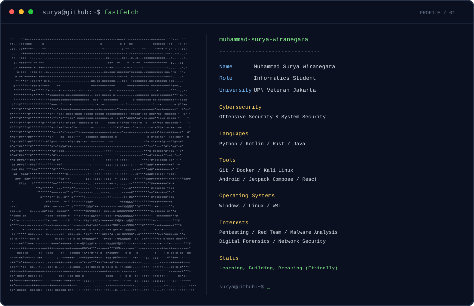

# `surya@github:~$ whoami`

  

**Headline:** Cybersecurity enthusiast

## `$ cat focus.txt`

- System & Network Security
- Application Security
- Software Engineering
- Open Source
- AI / ML for Cybersecurity
- CTF

## `$ cat languages.txt`

Python · C++ · Java · Kotlin · Rust · Bash · TypeScript

## `$ cat tools.txt`

Linux · Kali Linux · WSL · Git · Docker · MySQL · SQLite

## `$ ls ~/projects`

| Project | Description | Stack | Status |
|---|---|---|---|
| **KiVault** | Local-first desktop password and credential manager | Tauri 2, Rust, React, TypeScript, SQLite | Active development |
| **Kitsune** | Offline-first manga, comics, and video media library and reader for Android | Kotlin, Jetpack Compose, Room | Active development |

---
Focused on security, software, and open source.
